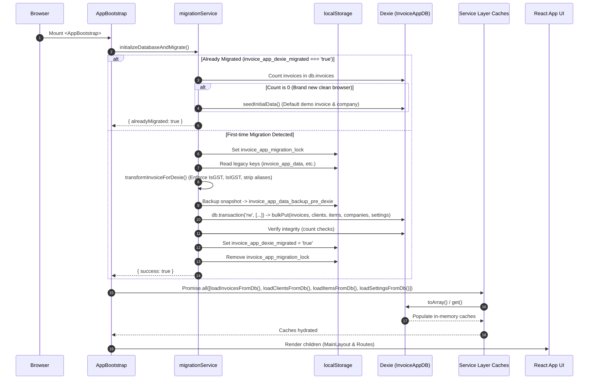

# Architecture Decision & Engineering Design Record

## 1. Architectural Philosophy & Principles

Invoice Manager is built around foundational software engineering principles designed to guarantee maintainability, high performance, and statutory compliance:

- **Single Responsibility Principle (SRP)**: UI components render views and handle user interaction; business services interface with the database and maintain state caches; statutory and mathematical domain rules reside exclusively in pure, testable utility functions.
- **Separation of Concerns (SoC)**: Presentation logic is completely decoupled from calculation and persistence logic. For instance, tax formulas and Grand Total equations live in `src/utils/invoiceCalculations.js` rather than being redundantly computed inside editor or preview components.
- **Offline-First Persistence via Dexie.js (IndexedDB)**: The application operates completely client-side without mandatory backend dependencies. Structured business records are stored in browser **IndexedDB** using **Dexie.js**, overcoming the 5 MB quota limits and synchronous main-thread blocking of `localStorage`.
- **Single Source of Truth for Data Contracts**: Every domain concept is represented by exactly one canonical property name throughout the application. Tax flags strictly use `IsGST` and `IsIGST`. Alternative property names, legacy aliases, and permanent fallback layers are strictly prohibited in active models.
- **Performance by Construction**: Zero-cost initial loads via route code-splitting, targeted Rollup vendor chunking, and a dual-layer data access pattern (IndexedDB persistence coupled with synchronous cache hydration and Dexie `useLiveQuery` reactivity) to prevent cascading re-renders and layout shifts.

---

## 2. System Architecture & Data Flow

The diagram below illustrates the end-to-end architecture, from application bootstrap and routing to service encapsulation, reactive database queries, and Dexie.js IndexedDB persistence.

```mermaid
flowchart TD
    subgraph Browser ["Browser Runtime"]
        Boot["AppBootstrap (src/components/AppBootstrap.jsx)"]
        Router["React Router DOM (App.jsx)"]
    end

    subgraph Presentation ["Presentation Layer (React Views & Layouts)"]
        Dashboard["Dashboard.jsx"]
        InvoicesView["Invoices.jsx"]
        InvoiceEditor["InvoiceEditor.jsx"]
        InvoicePreview["InvoicePreview.jsx"]
        CreateFromJson["CreateInvoiceFromJson.jsx"]
        ClientsView["Clients.jsx"]
        ItemsView["Items.jsx"]
        SettingsView["Settings.jsx"]
    end

    subgraph Reactivity ["UI Reactivity & State"]
        LiveQueries["dexie-react-hooks (useLiveQuery)"]
        MemCache["In-Memory Synchronous Caches"]
        ToastCtx["Toast Notification Context"]
    end

    subgraph Services ["Service Layer (Business Logic & Storage Encapsulation)"]
        MigrationSvc["migrationService.js"]
        InvoiceSvc["invoiceService.js"]
        ClientSvc["clientService.js"]
        ItemSvc["itemService.js"]
        SettingsSvc["settingsService.js"]
        BackupSvc["backupService.js"]
        ReportSvc["reportService.js"]
    end

    subgraph PureDomain ["Domain & Utility Layer (Pure Functions)"]
        JsonParser["jsonInvoiceParser.js"]
        Calculations["invoiceCalculations.js"]
        NumToWords["numberToWords.js"]
        Validators["validation.ts"]
        TemplatesRegistry["templates.js"]
        IdGen["idGenerator.js"]
    end

    subgraph StorageEngine ["Persistence Layer (Dexie.js / IndexedDB)"]
        DexieDB[("InvoiceAppDB (Dexie Instance)")]
        T_Invoices[("invoices")]
        T_Clients[("clients")]
        T_Items[("items")]
        T_Companies[("companies")]
        T_Settings[("settings")]
    end

    Boot -->|"1. Initialize & Migrate"| MigrationSvc
    Boot -->|"2. Hydrate Caches"| InvoiceSvc
    Boot -->|"2. Hydrate Caches"| ClientSvc
    Boot -->|"2. Hydrate Caches"| ItemSvc
    Boot -->|"2. Hydrate Caches"| SettingsSvc
    Boot -->|"3. Mount UI"| Router

    Router --> Presentation

    Presentation -->|"Reactive Subscriptions"| LiveQueries
    Presentation -->|"Fast Synchronous Fallbacks"| MemCache
    Presentation -->|"User Actions (CRUD)"| Services
    Presentation -->|"Statutory Calculations"| Calculations

    Services -->|"Atomic Transactions / CRUD"| DexieDB
    DexieDB --- T_Invoices
    DexieDB --- T_Clients
    DexieDB --- T_Items
    DexieDB --- T_Companies
    DexieDB --- T_Settings

    LiveQueries -.->|"Observes Table Changes"| DexieDB
    LiveQueries -->|"Triggers Auto Re-render"| Presentation

    CreateFromJson -->|"Parses & Normalizes"| JsonParser
    InvoiceSvc -->|"Enforces Invariants & UUID"| IdGen
    InvoiceSvc -->|"Auto Upsert Client"| ClientSvc
```



---

## 3. Application Startup Sequence & Bootstrap Lifecycle

The application enforces a deterministic initialization sequence via `AppBootstrap` (`src/components/AppBootstrap.jsx`) wrapped around the root route in `src/main.jsx`.



### Key Guarantees of Bootstrap Lifecycle:
1. **Zero Race Conditions**: No component can access or mutate database tables before migration verification and cache hydration complete.
2. **No Layout Shift or Flash of Unstyled Content**: Because in-memory caches are populated before mounting, initial page renders display hydrated records immediately.
3. **Resilient Error Boundary**: If IndexedDB fails to initialize (e.g. strict private browsing restrictions), a user-friendly error screen is displayed, safeguarding existing data.

---

## 4. Dexie.js Database Specification

The database is managed through the `InvoiceAppDatabase` class in `src/db/db.js`, subclassing `Dexie`.

- **Database Name**: `InvoiceAppDB`
- **Current Version**: `2`

```javascript
export class InvoiceAppDatabase extends Dexie {
    constructor() {
        super(DATABASE_NAME);

        this.version(1).stores({
            [TABLE_NAMES.INVOICES]: 'id, number, date, IsGST, IsIGST, template, recipient.name, recipient.gstNumber',
            [TABLE_NAMES.CLIENTS]: 'id, name, mobile, email, gstNumber, createdAt',
            [TABLE_NAMES.ITEMS]: 'id, name, hsnSac, defaultPrice, createdAt',
            [TABLE_NAMES.COMPANIES]: 'id, name, gstNumber, isDefault',
            [TABLE_NAMES.SETTINGS]: 'key'
        });

        this.version(2).stores({
            [TABLE_NAMES.TEMPLATES]: TEMPLATE_SCHEMA
        });
    }
}

export const db = new InvoiceAppDatabase();
```

### 4.1. Table: `invoices`

- **Purpose**: Primary store for all created, imported, and saved invoices.
- **Primary Key**: `id` (Supports both legacy numeric timestamps and collision-resistant RFC 4122 v4 UUID strings).
- **Indexes**:
  - `number`: Invoice numbering sequence (e.g., `#INV-001`, `#9`).
  - `date`: Invoice issue date (`YYYY-MM-DD`).
  - `IsGST`: Boolean flag (`true` or `false`).
  - `IsIGST`: Boolean flag (`true` or `false`).
  - `template`: Template identifier (e.g., `default`, `modern_indigo`).
  - `recipient.name`: Client/recipient business name for rapid search filtering.
  - `recipient.gstNumber`: Recipient GST identification number.
- **Relationships**:
  - Contains embedded `recipient` (InvoiceParty), which is auto-upserted into `clients`.
  - Contains embedded `sender` (InvoiceParty), initialized from active company profile in `companies`.
  - Contains embedded `items` (InvoiceItem[]), representing snapshot pricing for invoice lines.

#### Representative Record:
```json
{
  "id": "f81d4fae-7dec-11d0-a765-00a0c91e6bf6",
  "number": "#INV-2026-001",
  "date": "2026-11-17",
  "dueDate": "2026-12-01",
  "sender": {
    "name": "Acme Industrial Solutions",
    "address": "401 Tech Park, SG Highway, Ahmedabad, Gujarat",
    "phone": "9876543210",
    "email": "contact@acmeindustrial.com",
    "gstNumber": "24ABCDE1234F1Z5",
    "state": "24-Gujarat"
  },
  "recipient": {
    "name": "Global Logistics Corp",
    "address": "12 Port Road, Mundra, Kutch, Gujarat",
    "mobile": "9898012345",
    "email": "billing@globallogistics.com",
    "gstNumber": "24XYZPA9876K1ZQ",
    "state": "24-Gujarat"
  },
  "items": [
    {
      "id": 1,
      "description": "Hydraulic Crane Controller Overhaul",
      "quantity": 2,
      "price": 14500,
      "hsnSac": "8481",
      "unit": "Pcs",
      "gstRate": 18
    }
  ],
  "currency": "₹",
  "notes": "Payment due within 14 days of invoice receipt.",
  "termsAndConditions": "Goods once sold will not be taken back.",
  "paymentInfo": "UPI ID: acme@oksbi",
  "bankDetails": {
    "bankName": "HDFC Bank",
    "accountNumber": "50200012345678",
    "ifscCode": "HDFC0001234",
    "accountHolder": "Acme Industrial Solutions"
  },
  "IsGST": true,
  "IsIGST": false,
  "received": 5000,
  "discountType": "percentage",
  "discountValue": 5,
  "discountLabel": "Early Settlement Discount",
  "template": "modern_indigo"
}
```

---

### 4.2. Table: `clients`

- **Purpose**: Client directory and address book.
- **Primary Key**: `id` (Number or UUID).
- **Indexes**: `name`, `mobile`, `email`, `gstNumber`, `createdAt`.
- **Relationships**: Automatically populated or updated when invoices are saved with a recipient.

#### Representative Record:
```json
{
  "id": 1731427200001,
  "name": "Global Logistics Corp",
  "mobile": "9898012345",
  "email": "billing@globallogistics.com",
  "gstNumber": "24XYZPA9876K1ZQ",
  "address": "12 Port Road, Mundra, Kutch, Gujarat",
  "state": "24-Gujarat",
  "createdAt": "2026-11-17T06:30:00.000Z"
}
```

---

### 4.3. Table: `items`

- **Purpose**: Master inventory and service catalog with historical pricing.
- **Primary Key**: `id` (Number or UUID).
- **Indexes**: `name`, `hsnSac`, `defaultPrice`, `createdAt`.
- **Relationships**: Line items can be added directly from this table into the invoice editor.

#### Representative Record:
```json
{
  "id": 1731427200002,
  "name": "Hydraulic Crane Controller Overhaul",
  "description": "Full diagnostic teardown, testing, and component replacement",
  "defaultPrice": 14500,
  "hsnSac": "8481",
  "unit": "Pcs",
  "gstRate": 18,
  "priceHistory": [
    {
      "price": 14000,
      "date": "2026-05-10"
    },
    {
      "price": 14500,
      "date": "2026-11-17"
    }
  ],
  "createdAt": "2026-11-17T06:30:00.000Z"
}
```

---

### 4.4. Table: `companies`

- **Purpose**: Multi-company profiles for business identity, banking, and tax registration.
- **Primary Key**: `id` (String identifier, e.g., `default`, or UUID).
- **Indexes**: `name`, `gstNumber`, `isDefault`.
- **Relationships**: The profile with `isDefault: true` provides the default sender details when generating new invoices.

#### Representative Record:
```json
{
  "id": "default",
  "name": "Acme Industrial Solutions",
  "address": "401 Tech Park, SG Highway, Ahmedabad, Gujarat",
  "state": "24-Gujarat",
  "phone": "9876543210",
  "email": "contact@acmeindustrial.com",
  "gstNumber": "24ABCDE1234F1Z5",
  "bankDetails": {
    "bankName": "HDFC Bank",
    "accountNumber": "50200012345678",
    "ifscCode": "HDFC0001234",
    "accountHolder": "Acme Industrial Solutions"
  },
  "logo": "data:image/png;base64,iVBORw0KGgo...",
  "isDefault": true
}
```

---

### 4.5. Table: `settings`

- **Purpose**: Global application configuration (validation gates, display preferences, UPI payment defaults).
- **Primary Key**: `key` (String, e.g. `'app_config'`).
- **Indexes**: Primary key `key`.

#### Representative Record:
```json
{
  "key": "app_config",
  "value": {
    "validation": {
      "requireInvoiceNumber": true,
      "requireClientName": true,
      "requireClientMobile": false,
      "priceGreaterThanZero": true,
      "quantityGreaterThanZero": true,
      "requireItemDescription": true
    },
    "display": {
      "showLogo": true,
      "showQrCode": true,
      "showUnit": true
    },
    "payment": {
      "upiId": "acme@oksbi",
      "payeeName": "Acme Industrial Solutions"
    },
    "activeProfileId": "default",
    "selectedTemplateId": 1
  }
}
```

---

### 4.6. Table: `templates`

- **Purpose**: Master store for reusable invoice layout templates (HTML markup, CSS stylesheets, dynamic tokens).
- **Primary Key**: `id` (Auto-increment integer `++id`).
- **Indexes**:
  - `name`: Template display name (e.g. `'Classic'`, `'Modern'`, `'Minimal'`).
  - `isDefault`: Boolean indicator for whether the template is marked as the default layout.
  - `isBuiltIn`: Boolean distinguishing system templates (`true`) from user-created templates (`false`).
  - `updatedAt`: Date timestamp of last modification.
- **Dynamic Tokens Supported**: `{{sender.*}}`, `{{recipient.*}}`, `{{invoice.*}}`, `{{#items}}...{{/items}}`, `{{totals.*}}`, `{{bankDetails.*}}`, `{{paymentInfo}}`, `{{notes}}`, `{{termsAndConditions}}`.
- **Built-in Templates Seeded**:
  - `Classic` (`isDefault: true`): Traditional, formal invoice presentation with serif typography and bordered tables.
  - `Modern` (`isDefault: false`): Contemporary layout with sans-serif typography, brand color accent bar, and card-based hierarchy.
  - `Minimal` (`isDefault: false`): Monochromatic, print-optimized layout with hairline dividers and generous whitespace.

#### Representative Record:
```json
{
  "id": 1,
  "name": "Classic",
  "key": "classic",
  "isDefault": true,
  "isBuiltIn": true,
  "html": "<div class=\"invoice-container classic-layout\">...</div>",
  "css": ".classic-layout { font-family: 'Georgia', serif; ... }",
  "updatedAt": "2026-11-17T10:00:00.000Z"
}
```

---

## 5. Future Database Schema Upgrades via Dexie Versioning

Dexie provides declarative schema versioning. When altering tables or adding indexes in future releases, **never** modify past versions or drop databases. Add a new version block:

```javascript
// Example: Future v3 migration pattern
export class InvoiceAppDatabase extends Dexie {
    constructor() {
        super(DATABASE_NAME);

        // Version 1 (Baseline)
        this.version(1).stores({
            [TABLE_NAMES.INVOICES]: 'id, number, date, IsGST, IsIGST, template, recipient.name, recipient.gstNumber',
            [TABLE_NAMES.CLIENTS]: 'id, name, mobile, email, gstNumber, createdAt',
            [TABLE_NAMES.ITEMS]: 'id, name, hsnSac, defaultPrice, createdAt',
            [TABLE_NAMES.COMPANIES]: 'id, name, gstNumber, isDefault',
            [TABLE_NAMES.SETTINGS]: 'key'
        });

        // Version 2 (Templates store)
        this.version(2).stores({
            [TABLE_NAMES.TEMPLATES]: TEMPLATE_SCHEMA
        });

        // Version 3 (Example: Adding tags index to invoices and audit log table)
        this.version(3).stores({
            [TABLE_NAMES.INVOICES]: 'id, number, date, IsGST, IsIGST, template, recipient.name, recipient.gstNumber, *tags',
            audit_logs: 'id, entityType, entityId, timestamp'
        }).upgrade(async (tx) => {
            await tx.invoices.toCollection().modify((invoice) => {
                if (!invoice.tags) invoice.tags = [];
            });
        });
    }
}
```

---

## 6. One-Time Data Migration Architecture (localStorage to Dexie.js)

### 6.1. Migration Process Overview

The one-time migration (`src/services/migrationService.js`) safely moves legacy `localStorage` records to IndexedDB upon user startup:

1. **Detection**: Checks if `localStorage.getItem('invoice_app_dexie_migrated') === 'true'`. If true, the migration is skipped.
2. **Concurrency Locking**: Sets `localStorage.setItem('invoice_app_migration_lock', Date.now())` to prevent concurrent tab collisions.
3. **Extraction**: Reads raw JSON strings from legacy keys:
   - `invoice_app_data` $\to$ Invoices
   - `invoice_app_clients` $\to$ Clients
   - `invoice_app_items` $\to$ Catalog Items
   - `invoice_app_settings` $\to$ Settings & Company Profiles
4. **Data Transformation (`transformInvoiceForDexie`)**:
   - Resolves `IsGST` strictly to boolean (canonical boolean preserved; explicit `false` preserved).
   - Resolves `IsIGST` strictly to boolean.
   - Enforces invariant: If `IsGST === false`, `IsIGST` is coerced to `false`.
   - Strips legacy keys: `delete invoice.isGST`, `delete invoice.isIGST`, `delete invoice.gst`, `delete invoice.GST`, `delete invoice.igst`, `delete invoice.IGST`, `delete invoice.taxEnabled`.
   - Guarantees valid identifier: assigns UUID if `invoice.id` is missing.
5. **Pre-Migration Safety Snapshot**: Before modifying storage, stores an unmolested raw backup copy in `localStorage.getItem('invoice_app_data_backup_pre_dexie')`.
6. **Atomic Dexie Insertion**: Uses `db.transaction('rw', [...])` with `bulkPut()` so that if any insertion fails, the entire transaction rolls back cleanly.
7. **Post-Insertion Verification**: Asserts that `await db.invoices.count() >= invoicesToInsert.length`.
8. **Completion Marking**:
   - Sets `localStorage.setItem('invoice_app_dexie_migrated', 'true')`.
   - Sets `localStorage.setItem('invoice_app_schema_version', '2')`.
   - Cleans up `invoice_app_migration_lock`.

### 6.2. Failure Handling & Manual Recovery

If an unexpected exception halts migration:
- The transaction automatically rolls back in Dexie.
- The `MIGRATION_MARKER` is **not** set, ensuring safe re-attempt on next reload.
- The raw data remains intact in `localStorage` (`invoice_app_data` and snapshot `invoice_app_data_backup_pre_dexie`).
- **Manual Recovery**: If needed, developers can extract the pre-migration snapshot from browser DevTools:
  ```javascript
  const backup = localStorage.getItem('invoice_app_data_backup_pre_dexie');
  console.log(JSON.parse(backup));
  ```

---

## 7. Invoice Data Model & GST Architecture

### 7.1. Strict Property Contract

The application maintains **zero tolerance** for alternative or legacy property names. The invoice data model is strictly typed (`src/types/invoice.ts`):

```typescript
export interface Invoice {
  id: number | string;
  number: string;
  date: string;
  dueDate?: string;
  sender: InvoiceParty;
  recipient: InvoiceParty;
  placeOfSupply?: string;
  items: InvoiceItem[];
  currency: string;
  notes?: string;
  termsAndConditions?: string;
  paymentInfo?: string;
  bankDetails: BankDetails;
  
  // STATUTORY TAX FLAGS - SINGLE SOURCE OF TRUTH
  IsGST: boolean;
  IsIGST: boolean;

  gstRate?: number;
  cgst?: number;
  sgst?: number;
  received: number;
  discountType: 'fixed' | 'percentage';
  discountValue: number;
  discountLabel?: string;
  customization?: InvoiceCustomization;
  template?: string;
}
```

### 7.2. Tax Flag Responsibilities & Calculation Behavior

| Property | Type | Default | Responsibility |
| :--- | :--- | :--- | :--- |
| `IsGST` | `boolean` | `false` | Master toggle governing whether tax is applicable. When `false`, tax calculation is bypassed, tax totals are 0, and GST columns are hidden. |
| `IsIGST` | `boolean` | `false` | Specifies interstate vs. intrastate tax division. Active **only** when `IsGST` is `true`. |

#### Calculation Rules (`src/utils/invoiceCalculations.js`):
1. **When `IsGST === false`**:
   $$\text{Tax Amount} = 0, \quad \text{CGST} = 0, \quad \text{SGST} = 0, \quad \text{IGST} = 0$$
   $$\text{Pre-Discount Total} = \text{Subtotal}$$
2. **When `IsGST === true` and `IsIGST === false` (Intrastate)**:
   $$\text{Tax Amount} = \sum (\text{Line Item Subtotal} \times \frac{\text{GST Rate}}{100})$$
   $$\text{CGST Amount} = \frac{\text{Tax Amount}}{2}, \quad \text{SGST Amount} = \frac{\text{Tax Amount}}{2}, \quad \text{IGST Amount} = 0$$
3. **When `IsGST === true` and `IsIGST === true` (Interstate)**:
   $$\text{IGST Amount} = \text{Tax Amount}, \quad \text{CGST Amount} = 0, \quad \text{SGST Amount} = 0$$

---

## 8. JSON Invoice Import and Export Workflow

The application supports importing invoices from structured JSON payloads (`CreateInvoiceFromJson.jsx` via `src/utils/jsonInvoiceParser.js`).

### 8.1. Supported JSON Import Schema (`RawJsonInvoice`)

```json
{
  "invoiceNumber": "INV-2026-88",
  "issueDate": "2026-11-17",
  "dueDate": "2026-12-01",
  "template": "modern_indigo",
  "IsGST": false,
  "IsIGST": false,
  "currency": "₹",
  "client": {
    "name": "Precision Engineering Ltd",
    "mobile": "9876543210",
    "email": "accounts@precisioneng.com",
    "address": "Plot 42, GIDC Industrial Estate, Vadodara",
    "gstNumber": "24AABCP1234F1Z8",
    "state": "24-Gujarat"
  },
  "items": [
    {
      "description": "CNC Precision Milling Service",
      "quantity": 10,
      "price": 1200,
      "hsnSac": "9988",
      "unit": "Hrs",
      "gstRate": 18
    }
  ],
  "discountType": "percentage",
  "discountValue": 5,
  "discountLabel": "Volume Rebate",
  "notes": "Thank you for your business!"
}
```

### 8.2. Precedence and Resolution Hierarchy (`resolveInvoiceData`)

When a user imports JSON on `CreateInvoiceFromJson.jsx`:
1. **Client Selection Precedence**:
   - **Manual selection from Directory** (Highest): Completely overrides JSON client details. No blending occurs.
   - **JSON Client** (Fallback): Used if no directory client is selected.
   - **Blank Profile** (Default): If neither is present.
2. **Template Precedence**:
   - **Manual Dropdown Selection** (Highest).
   - **JSON Template ID** (Fallback if valid ID).
   - **Default Template (`default`)** (Final fallback).
3. **GST Flag Precedence**:
   - Manual UI toggle takes precedence over JSON flags if explicitly flipped.
   - Defaults strictly to `false` when omitted in JSON.
   - Invariant: `IsGST: false` forces `IsIGST: false`.

### 8.3. Full Database Backup & Restore (`backupService.js`)

Users can export a complete JSON backup of the entire Dexie database via **Settings $\to$ Backup & Restore**:
- Generates `invoice_app_full_backup_YYYY-MM-DD.json`.
- Restores all tables (`invoices`, `clients`, `items`, `companies`, `settings`) atomically in a Dexie read-write transaction.
- Automatically passes all imported invoices through `transformInvoiceForDexie` to ensure GST standardization.

---

## 9. Developer Guidelines & Architecture Conventions

1. **Encapsulate Storage in Services**:
   - React components **must not** call `db.invoices.add()` or `db.invoices.put()` directly.
   - Always use `invoiceService.js`, `clientService.js`, `itemService.js`, or `settingsService.js`.
2. **Use `useLiveQuery` for UI Reactivity**:
   - To render reactive tables or dashboard statistics, import `useLiveQuery` from `dexie-react-hooks`.
   - Wrap fallback defaults in `useMemo` to adhere to React Hook dependency rules.
3. **No Direct `localStorage` for Invoices**:
   - `localStorage` is prohibited for invoice, client, or company persistence. It is used exclusively for one-time migration markers (`invoice_app_dexie_migrated`) and disaster recovery snapshots.
4. **Strict GST Property Usage**:
   - Never use `isGST`, `gst`, or `taxEnabled`. Always use `IsGST` and `IsIGST`.
5. **Schema Changes via Dexie Versions**:
   - Never delete existing stores or wipe user databases. Increment `this.version(N)` and use `.upgrade()`.
